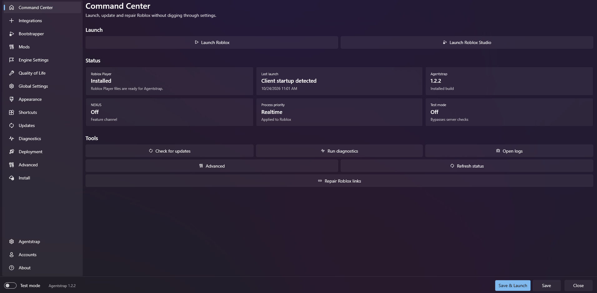

> [!CAUTION]
> The only official place to download Agentstrap is this GitHub repository and the
> [Agentstrap documentation site](https://agentstrap-doc.pages.dev). Any other website offering downloads or
> claiming to be us is not owned by us.


> [!TIP]
> The docs site is currently down.

---

<div align="center">


# Agentstrap

**A third-party replacement for the standard Roblox bootstrapper, with a lot more going on.**

[![License][shield-repo-license]][repo-license]
[![Downloads][shield-repo-releases]][repo-releases]
[![Version][shield-repo-latest]][repo-latest]

</div>




---

Agentstrap takes over the job Roblox's own launcher does, and uses that position to add things Roblox doesn't
offer: a matchmaker, an in-game server overlay, a diagnostics suite, deployment channel pinning, modding that
survives updates, and more.

It is a fork of [Bloxstrap](https://github.com/bloxstraplabs/bloxstrap), and everything Bloxstrap does,
Agentstrap does. (Bloxstrap support/development has ended. It is a full ROBLOX bootstrapper though)

Running into a problem or need help with something? The documentation is in [`docs/`](docs) in this
repository, and online at the [docs site](https://agentstrap-doc.pages.dev). If you can't find
anything, or would like to suggest something, please
[submit an issue](https://github.com/agentxco2-dev/Agentstrap/issues).

Agentstrap is only supported for PCs running Windows.

## Features

### New in Agentstrap

- **Matchmaker** — join a place automatically on launch, optionally preferring servers that aren't already full
- **Command Center** — launch, update and repair Roblox from a single screen, with live status for every part
  of the install
- **Server connection overlay** — a toast on the game window telling you which server you landed on and where
  its data centre is
- **Diagnostics** — eight health checks that find broken installs, bad permissions, conflicting mods and
  pending configuration migrations
- **Deployment channels** — pin Agentstrap to a specific Roblox release channel instead of following
  production
- **Custom window attributes** — force a fixed size, position and title on the Roblox window every time
- **Updates page** — check Agentstrap, your installed mods and your configuration independently
- **NEXUS mode** - an opt-in experimental feature channel
- **Global Settings** - Roblox settings to save in Agentstrap that go to Roblox :)

### From Bloxstrap

- Hassle-free Discord Rich Presence, so your friends know what you're playing at a glance
- Modding of content files — cursor, sounds, emoji font, custom font, skybox — that survives Roblox updates
- Server location hints, courtesy of [ipinfo.io](https://ipinfo.io)
- Fast Flag management, with rendering presets, preset bundles and a flag validator
- Custom themes, custom shortcuts, and a configurable bootstrapper

Full documentation for every one of these lives in [`docs/`](dpcs).

## Installing

Download the [latest release of Agentstrap](https://github.com/agentxco2-dev/Agentstrap/releases/latest) and run
it. The installer asks where you want the app to live, and whether you want desktop and Start Menu shortcuts.
That's about it!

Agentstrap targets **.NET 10** and the published builds are self-contained, so you don't need to install a
separate runtime.

It's not unlikely that Windows SmartScreen will show a popup when you run Agentstrap for the first time. This
happens because it's an unknown program, not because it's actually detected as being malicious. To dismiss it,
click **More info** and then **Run anyway**.

Once installed, Agentstrap is added to your Start Menu, where you can access the menu and reconfigure your
preferences.

## Frequently Asked Questions

**Q: Is this malware?**

**A:** No. The source code here is viewable to all, and it'd be impossible to slip anything malicious into the
downloads without anyone noticing. Just be sure you're downloading it from an official source — this GitHub
repository is the only one.

**Q: Can using this get me banned?**

**A:** No, it shouldn't. Agentstrap doesn't interact with the Roblox client in the same way that exploits do. It
changes *how* Roblox is launched and *what* gets copied into the install folder, not the client itself. See
[Agentstrap and bans](docs/info/bans.html) for the details.

**Q: Does Agentstrap send my data anywhere?**

**A:** There's no analytics backend. The only outbound requests are Roblox downloads, the
GitHub release check, and — if you turn them on — ipinfo.io server location lookups and per-mod update checks.
See the [privacy policy](docs/info/privacy-policy.html).

---

## Code

Agentstrap uses the [WPF UI](https://github.com/lepoco/wpfui) library for the user interface design, vendored as
a submodule in `wpfui/`.

```powershell
git clone --recurse-submodules https://github.com/agentxco2-dev/Agentstrap
dotnet build Agentstrap/Agentstrap.csproj -c Release
```

If you cloned without `--recurse-submodules`, run `git submodule update --init` first — the build fails without
it.

To publish a self-contained x64 build:

```powershell
dotnet publish Agentstrap/Agentstrap.csproj -p:PublishProfile=Publish-x64 -c Release
```

There's a test project alongside the app:

```powershell
dotnet test Agentstrap.Tests/Agentstrap.Tests.csproj
```

## Credits

Agentstrap is a fork of [Bloxstrap](https://github.com/bloxstraplabs/bloxstrap) by
[pizzaboxer](https://github.com/pizzaboxer), and would not exist without it. Okay, maybe it would, but Agentstrap would be WAY worse without Bloxstrap.. Anyways, Roblox and Roblox Studio are
trademarks of Roblox Corporation. 

[shield-repo-license]:  https://img.shields.io/github/license/agentxco2-dev/Agentstrap
[shield-repo-releases]: https://img.shields.io/github/downloads/agentxco2-dev/Agentstrap/latest/total?color=981bfe
[shield-repo-latest]:   https://img.shields.io/github/v/release/agentxco2-dev/Agentstrap?color=7a39fb

[repo-license]:  https://github.com/agentxco2-dev/Agentstrap/blob/main/LICENSE
[repo-releases]: https://github.com/agentxco2-dev/Agentstrap/releases
[repo-latest]:   https://github.com/agentxco2-dev/Agentstrap/releases/latest
